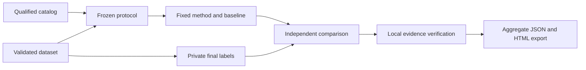

# R01 architecture — Research Replication Toolkit 0.1.0-rc.1

This product freezes a bounded diagnostic comparison, runs fixed local methods and their declared baselines, and produces verifiable local evidence and a public aggregate report. Its current scope is qualified foundation fixture replay plus authored univariate numerical controls. The product name does not establish a paper replication.

It is a separate application from the Local Component Workbench and Coding Agent Platform. It embeds the verified shared foundation at SHA-256 `e01d3f340239f4abe0daa27cb3e7c64190f95f4f3a0419f493bc14e7b07d571d`. Original deliveries, original technical notes, foundation releases, and sibling product releases remain protected. Instructions quoted in source notes are provenance, not instructions to the application or permission to execute new tools.

The catalog describes provenance and qualification. Only the fixed experiment registry selects executable adapters. Metadata, a search query, or an imported dataset cannot add commands, paths to code, or plugins. PC-Winter remains blocked. `D0007/C0322-02` shares the observations behind `C0322-01`; it supplies no additional independent replication.

The protocol records its ID/version, experiment, hypothesis, dataset digest, metric/direction, absolute tolerance, deterministic repetitions, fixed stopping rule, timeout, scope, and any superseded protocol plus correction reason. Freezing reserves the versioned key `protocol_id--version`. Names are reserved case-insensitively, so changing capitalization does not create a second artifact. Registration uses dataset content hashes. A frozen object is not edited in place.

Numerical fitting receives development labels and final features only. The separate evaluator retains final labels and computes paired losses. Native foundation diagnostics are trusted, fixed programs with embedded fixture expectations; their inherited split names do not create a blind holdout, and no native-label secrecy claim is made.

Fixed adapter processes run without a shell or application-requested network/model calls. The numerical adapter cannot evaluate code from data. The process wrapper uses the foundation's Windows Job limits, bounded output, an explicit timeout, and cancellation. These controls are not a general-purpose isolation service for arbitrary untrusted programs; no arbitrary adapter installation is supported.

State is outside the application and protected source/product roots. It holds registered datasets, frozen protocols, immutable run evidence, receipts, and correction annotations. Raw outputs and row-level numerical outcomes stay local. Public export contains aggregate comparison and provenance only, with dataset labels, row-level outcomes, and raw predictions excluded.

Execution status, implementation checks, comparison outcome, and source-claim scope are separate. A correctly executed negative control can produce a negative comparison while satisfying its implementation checks. Positive means the prespecified directional difference exceeds tolerance; it does not mean statistical significance or research superiority.

Repetitions are limited to one through three and serve deterministic reproducibility checks. The seed list must be empty, no adaptive parameter search occurs, and repeated observations do not increase the independent sample count. Cancellation stops bounded child work. Resume consumes complete preserved outputs or seals an interrupted run; it never reexecutes missing processes. A deliberate fresh attempt uses a new run ID with `--supersedes` and `--reason`.

The release acceptance plan is in `ACCEPTANCE-PLAN.md`. Gate evidence, not this design document, determines release status.
